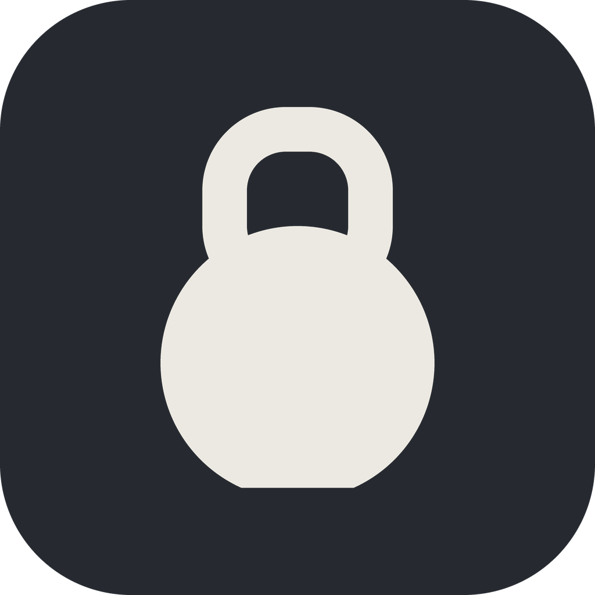
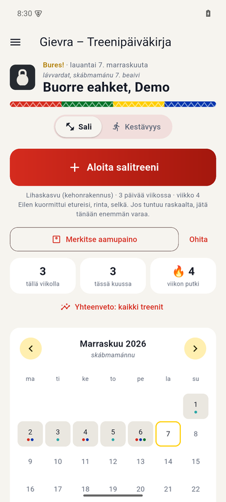
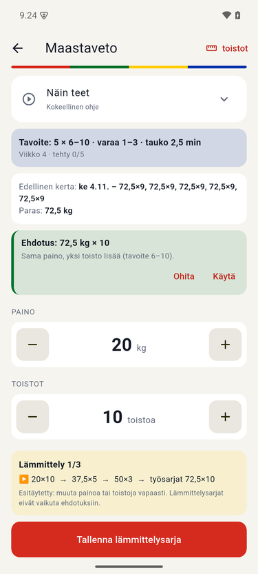
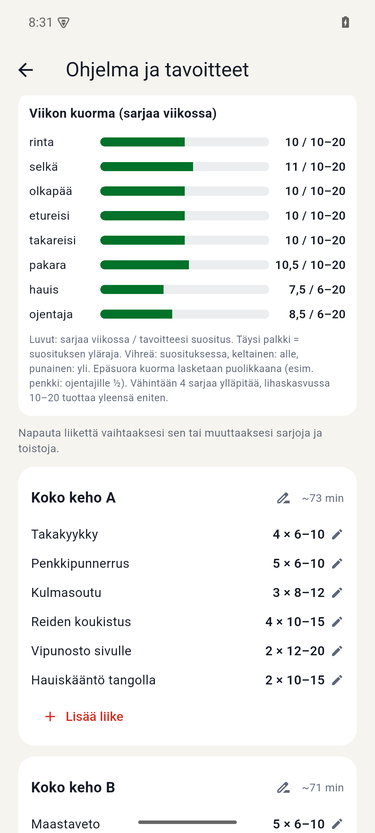
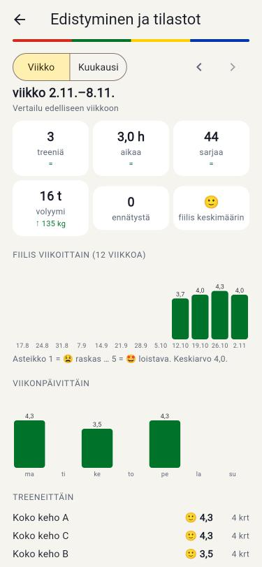

<p align="center">
  
</p>

<h1 align="center">Gievra – Treenipäiväkirja</h1>

<p align="center">
  <b>Sinun treenisi, sinun tiedostosi.</b><br>
  Maksuton ja avoin treenipäiväkirja salille ja kuntoiluun · ei tiliä · ei mainoksia · toimii ilman verkkoa
</p>

<p align="center">
  <i>Gievra</i> on pohjoissaamea ja tarkoittaa <i>vahvaa</i>. Bures! 👋
</p>

<p align="center">
  <a href="https://sombyduodji.github.io/gievra/"><b>Kotisivu</b></a> ·
  <a href="https://sombyduodji.github.io/gievra/app/"><b>Kokeile selaimessa</b></a> ·
  <a href="https://github.com/sombyduodji/gievra/releases/latest/download/Gievra-android-arm64.apk"><b>Lataa Androidille</b></a> ·
  <a href="#palaute">Palaute</a>
</p>

<p align="center"><a href="https://sombyduodji.github.io/gievra/">▶ Katso esittelyvideo (2 min)</a></p>

<p align="center">
  
  
  
  
</p>

---

## Mikä Gievra on?

Gievra on treenipäiväkirja, joka pitää treenisi sinun omissa tiedostoissasi. Jokainen treeni on tavallinen
Markdown-tiedosto valitsemassasi kansiossa, joten ne aukeavat millä tahansa tekstieditorilla ja kulkevat
laitteelta toiselle Nextcloudin, Syncthingin tai muun synkronoinnin mukana. Sovelluksessa ei ole tiliä,
mainoksia eikä analytiikkaa, eikä se lähetä tietojasi minnekään.

Gievrassa on saamelaishenkinen väriteema: värit tulevat saamen lipusta, koristenauha gáktin reunuksista ja
tervehdys on aina saameksi (*Buorre iđit!*, *Buorre eahket!*).

## Kokeile selaimessa

**[sombyduodji.github.io/gievra/app](https://sombyduodji.github.io/gievra/app/)** on sovelluksen demo:

- valmiina neljän viikon esimerkkitreenit: näet etusivun, kalenterin, tilastot ja treenin kirjauksen
- mitään ei tallenneta: kokeile vapaasti, sivun päivitys palauttaa demon alkuun
- **tee oma treeniohjelma**: *Tee oma treeniohjelma* -painike etusivulla (tai ☰ → Ohjelma ja tavoitteet →
  Tee uusi ohjelma), lopuksi *Tallenna pohja*. Saat
  ohjelmapohjan (`.gmd`), jonka voit tuoda puhelimen sovellukseen tai lähettää kaverille
- verkkoversio ei ota yhteyttä Googleen tai muihin palveluihin: fontit ja emojit tulevat samalta palvelimelta

## Mitä se osaa

**Treenin kirjaus yhdellä kädellä**
- isot +/– -säätimet, edellinen kerta ja paras tulos näkyvissä, ennätykset 🏆
- sarja tallentuu yhdellä napautuksella samalla kun vastaat *jäikö varaa?* (Ei yhtään / Muutama / Reilusti)
- lämmittelysarjat valmiiksi täytettyinä työpainon mukaan (esim. 120 kg kyykkyyn 20 → 60 → 85 → 102,5 kg)
- painoehdotus seuraavaan kertaan edellisen treenin perusteella
- *Miltä tuntui?* viidellä hymiöllä 😫 😕 😐 🙂 🤩; raskaan treenin jälkeen voi kertoa, mikä liike oli liian
  raskas tai oliko vain rankka päivä, ja seuraava ehdotus ottaa sen huomioon
- palautusajastin (valinnainen): raskaissa ja lähellä maksimia pidempi tauko, lämmittelyissä ja kevennysviikolla
  lyhyempi, omat ajat kuormaluokittain ±15 s; ilmoitus valitulla äänellä ja värinällä myös näytön ollessa pois päältä
  tai toisessa sovelluksessa
- treenin ajastin, *Treeni valmis!* ja vertailu edelliseen kertaan, useampi treeni samana päivänä
  (*Lisää uusi treeni*), jakaminen

**Valmiit treeniohjelmat**
- lyhyt aloituskysely: tavoite (voimanosto, lihaskasvu, rasvanpoltto, yleiskunto, fiiliksellä), kokemus,
  välineet, päivät, kesto ja toistoalue – tai lähtökohdaksi oma treenihistoria FitNotesista; ennätykset valinnaisia
  (historiasta löytyvät valmiina, muut *Lisää ennätys* -painikkeella)
- voimanoston 10 viikon sykli, kevennysviikot, painot arvioidusta maksimista
- kahvakuulaohjelmat painotuksen mukaan: voima, lihaskasvu, kunto tai perusta yhdellä kuulalla
- kehonpainolla treenaaminen ilman salia
- ohjelman tarkistus: työntö- ja vetoliikkeiden tasapaino, liikemallit, viikon kuorma lihasryhmittäin
- valitse liikkeet itse, vaihda, lisää ja poista; jokainen muutos arvioidaan

**Ohjelmapohjat ja ohjelmien vaihto**
- tallenna ohjelma `.gmd`-tiedostoksi ja lähetä toiselle, tuo valmentajan tai kaverin pohja
- Androidilla `.gmd` aukeaa suoraan Gievralla (*Avaa sovelluksella* tai *Jaa → Gievra*)
- tallennetut ohjelmat: vaihda ohjelmaa milloin vain, treenihistoria säilyy

**Liikkeet ja ohjeet**
- 147 liikettä: voimanosto, vapaat painot, laitteet, kahvakuula (myös kahdella kuulalla) ja kehonpaino
- *Näin teet*: liikeanimaatio ja tekniikkavinkit jokaiselle liikkeelle
- oikea mittaustapa: lankku sekunteina, askelkyykkykävely askelina, kannot edestakaisina

**Seuranta ja ehdotukset, jotka voi ohittaa**
- yhteenveto viikolta, kuukaudelta, 3 tai 6 kuukaudelta ja vuodelta: kaikki treenit yhdessä tai sali ja kestävyys
  erikseen (kerrat, aika, sarjat, volyymi, kilometrit, syke, lajeittain), treenit viikoittain tai kuukausittain;
  mukana myös FitNotesista ja Garminista tuodut treenit; voimakehitys, fiilis viikonpäivittäin ja treeneittäin
- kehonpainon seuranta (valinnainen): *Tämän päivän paino* etusivulla, kun et ole vielä punninnut (pilkku tai piste
  käy), painon kehitys ja painoindeksi tilastoissa, punnitukset ja pituus asetuksissa; tallentuu `kehonpaino.md`:hen;
  FitNotesin punnitukset tuodaan mukana
- vammatila: 20 kehon aluetta, liikkeiden välttäminen ja korvaaminen
- sairas- ja lomatauko kevyemmällä paluulla, palautumisen huomiointi
- **Sali, Kestävyys tai Molemmat:** valitse aloituksessa (tai asetuksista), mitä treenaat. Molemmissa etusivulla
  on Sali / Kestävyys -valinta; kestävyysnäkymässä lenkin lisäys yhdellä napautuksella, viikon kilometrit, vauhti ja syke
- urheilulajit (juoksu, hiihto, salibandy, squash …) sekä sykemittarin ja älykellon tiedot
  (kesto, kalorit, keski- ja maksimisyke heti *Treeni valmis!* -näkymässä; kirjoitetaan toistaiseksi käsin, suoraa
  yhteyttä kelloon tai Health Connectiin ei vielä ole)
- juoksulle oma kehitysnäkymä, erillään salista: lenkin tyyppi (kevyt, palauttava, pitkä, vauhtikestävyys,
  intervallit, kisavauhti, kilpailu), tarkka aika, vauhti min/km ja keskinopeus, kilometrit viikoittain, kevyiden
  lenkkien vauhti ja syke neljän viikon välein sekä ennätykset (5 km, 10 km, puolimaraton, maraton)

**Tiedostot ovat sinun**
- treenit, asetukset ja ohjelma tavallisina `.md`-tiedostoina omassa kansiossasi
- tuonti FitNotesista ja Garmin Connectista (suoritusten CSV-vienti: laji, aika, matka, kesto, kalorit ja syke),
  varmuuskopio zip-tiedostona, yksittäisten `.md`-tiedostojen tuonti

## Kielet

| Kieli | Tila |
|---|---|
| **Suomi** | oletus, koko sovellus; liikkeiden ja lajien nimet suomeksi, englanniksi tai molemmilla (asetus) |
| **Davvisámegiella** (pohjoissaame) | kokeellinen käyttöliittymä, kaikki tekstit ja lajien nimet. Käännökset ovat toistaiseksi konekäännöksiä, jotka on tarkistettu saamen oikolukijalla, mutta niissä voi olla virheitä. Liikkeiden nimet suomeksi, englanniksi tai molemmilla (asetus); liikeohjeet suomeksi. |
| **English** | koko käyttöliittymä (oikoluettu Hunspellilla); liikkeiden ja lajien nimet aina englanniksi; haku löytää molemmilla kielillä. Tiedostot tallentuvat aina samassa muodossa, joten kieltä voi vaihtaa milloin vain. |

Korjaukset käännöksiin ovat erityisen tervetulleita, ks. [docs/kaannokset.md](docs/kaannokset.md).

## Huomioitavaa

Liikeohjeet, animaatiot ja ohjelmat on koottu tutkimuksista ja avoimista oppikirjoista, mutta ammattilainen ei
ole vielä tarkistanut niitä. Varmista oikea tekniikka valmentajalta tai fysioterapeutilta ennen raskaita
painoja. Vammatila ei korvaa lääkärin tai fysioterapeutin arviota.

## Palaute

**Palaute on enemmän kuin tervetullutta!** Virheet, puuttuvat liikkeet, oudon näköiset liikeohjeet, ideat ja
käännöskorjaukset:

- sovelluksessa: ☰ → *Ilmoita ongelmasta* (liitteeksi treenitiedostot ja kuvakaappaukset) tai *Lähetä palautetta*
- sähköposti: [treeni@somby.fi](mailto:treeni@somby.fi)
- GitHubissa: [virheilmoitukset ja ehdotukset](../../issues)

## Avoin lähdekoodi

Gievra on vapaa ohjelma [GNU GPL v3.0](LICENSE) -lisenssillä: saat käyttää, tutkia, muokata ja jakaa sitä,
kunhan muokatut versiot jaetaan samalla lisenssillä. Sovelluksen käyttämien kirjastojen ja fonttien lisenssit
näkyvät sovelluksessa (☰ → Tietoa → Avoin lähdekoodi ja lisenssit).

Rakentaminen (Flutter):

```bash
flutter pub get
flutter test
flutter build apk --release
```

Lisää: [docs/KEHITYS.md](docs/KEHITYS.md) (tiedostomuoto, rakenne), [docs/verkkoversio.md](docs/verkkoversio.md)
(verkkoversio ja `.gmd`-muoto) ja [docs/tutkimus/](docs/tutkimus/) (lähteet).

**Lisälupa (GPL v3, kohta 7):** *If you modify this Program, or any covered work, by linking or combining it
with Google Play services libraries (or a modified version of those libraries), containing parts covered by the
terms of their licenses, the licensors of this Program grant you additional permission to convey the resulting
work.*

## Tue

Gievra on ja pysyy maksuttomana. Jos se on sinulle hyödyllinen, voit tarjota kahvit:
[buymeacoffee.com/sombyduodji](https://buymeacoffee.com/sombyduodji) ☕

---

**In English:** Gievra (North Sámi for *strong*) is a free, open-source training log for the gym and sports,
in Finnish and English, with an experimental North Sámi interface. Workouts are plain
Markdown files in a folder you choose; no account, no ads, no tracking. It builds evidence-based programs
(including kettlebell programs), prefills warm-up sets, adapts suggestions to your feedback, and shares programs
as `.gmd` templates. Try the demo and program builder in your browser:
[sombyduodji.github.io/gievra/app](https://sombyduodji.github.io/gievra/app/). Feedback is very welcome.

Tekijä: Juha Somby · [treeni@somby.fi](mailto:treeni@somby.fi)
